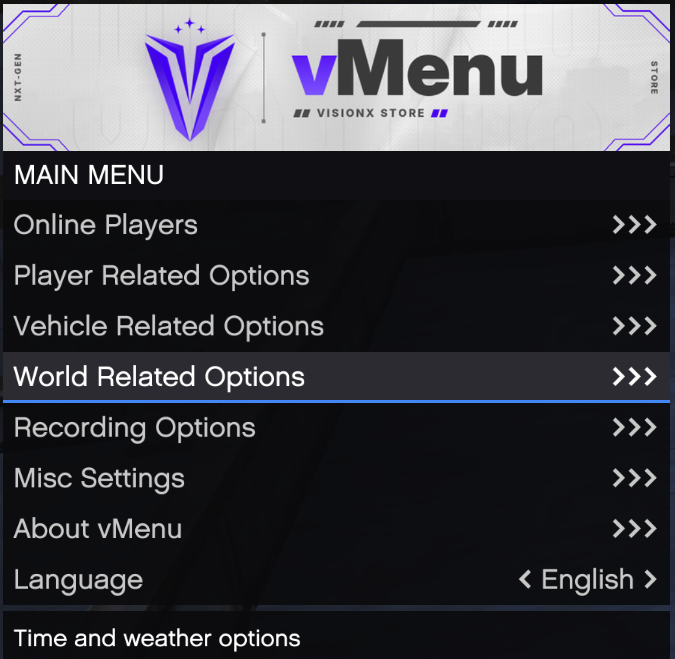
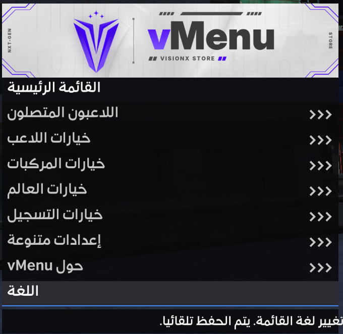
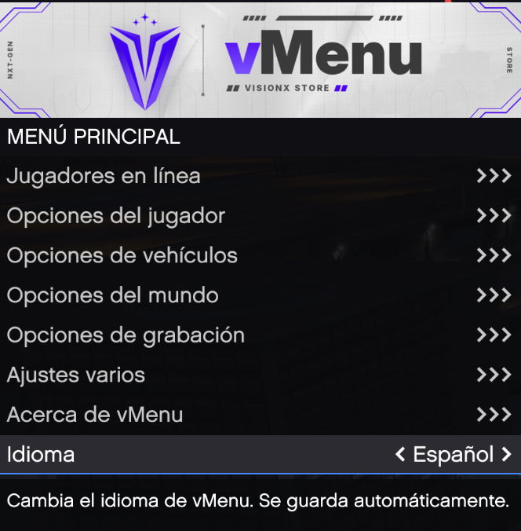
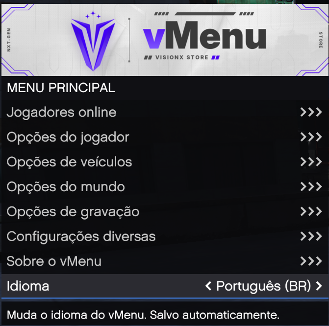
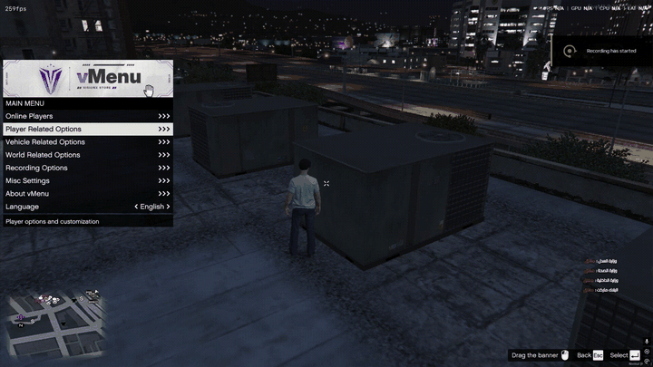
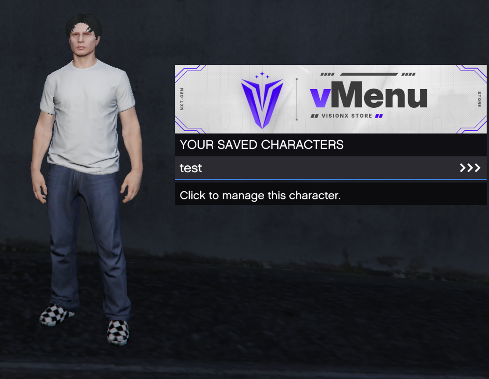
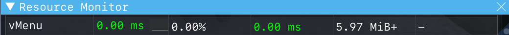
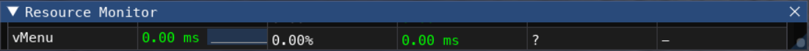

# vMenu-lua

A full **Lua rewrite of [vMenu](https://github.com/TomGrobbe/vMenu)** for FiveM, with no C# and no Mono runtime, plus a set of new features: multi-language support (including real Arabic text), a 3D ped preview, custom banners, a draggable menu, a dark theme and more.

> **Credits:** vMenu was created by **[Tom Grobbe (Vespura)](https://github.com/TomGrobbe)**.
> Original project: **https://github.com/TomGrobbe/vMenu**. All credit for the original menu, its design and its feature set goes to him and the vMenu contributors (Deltanic, Brigliar, IllusiveTea, Shayan Doust, zr0iq, Golden and others).
> This repository is a community conversion to Lua and is released under the terms of the [original vMenu license](https://github.com/TomGrobbe/vMenu/blob/master/LICENSE.md). **It is free, and it may not be sold.**

---

## Screenshots

The same menu in four of the five languages, switched live from the **Language** option:

<table>
  <tr>
    <td align="center"><br><b>English</b></td>
    <td align="center"><br><b>العربية (Arabic)</b></td>
  </tr>
  <tr>
    <td align="center"><br><b>Español</b></td>
    <td align="center"><br><b>Português (BR)</b></td>
  </tr>
</table>

### Move the menu anywhere

Hold **Left Alt** and drag the banner. The position is saved per player, and the key hint bar in the bottom-right shows the controls.

<p align="center"></p>

### See a character before you wear it

While browsing *Saved Characters* or *Saved Peds*, a 3D preview of the selected character stands beside the menu with its exact clothes, tattoos and face. Hold **Q / E** to rotate it.

<p align="center"></p>

---

## Why a Lua version?

The original vMenu is written in C# and runs on FiveM's Mono runtime. On busy servers that adds noticeable client and server load, and C# makes the menu harder for most FiveM developers to read or change.

vMenu-lua keeps the vMenu you know (same menus, same options, same ACE permission names) but:

- runs **100% in Lua**, so there's no C#/Mono runtime, build step or DLLs;
- is built to **keep resource usage low**: menu threads sleep when the menu is closed, and permission checks are cached;
- is **plain, readable Lua** that any FiveM developer can edit.

**Resource Monitor (`resmon`):**




---

## What's new compared to the original

| Feature | Description |
|---|---|
| **Languages** | English, Arabic, Spanish, Brazilian Portuguese and German. Each player picks their own from the **Language** option in the main menu; it's saved per player and changes live. |
| **Real Arabic text** | Arabic letters are joined and shown right-to-left correctly, mixed with English names and numbers. Uses a GFx font with Arabic glyphs. |
| **3D ped preview** | While browsing *Saved Peds* or *Saved MP Characters*, a preview of the ped stands beside the menu with its clothes, tattoos and face. Hold **Q / E** to rotate it. |
| **Custom banner** | Use your own PNG, JPG, animated GIF or image URL as the menu header. |
| **Draggable menu** | Hold **Left Alt** and drag the banner to move the menu anywhere; the position is saved. A *Reset Menu Position* button is in *Misc Settings*. |
| **Dark theme** | A dark menu style with an accent line, selectable per player. |
| **Instructional buttons** | A bottom-right key hint bar (select, back, move menu, rotate preview), translated like the rest of the menu. |
| **Super jump levels** | *Super Jump* has levels 1–5. Level 1 is the original super jump; higher levels jump higher. |
| **Faster permissions** | Permissions are resolved once per player with each ACE checked only once, instead of the same checks running again for every option. |
| **Update check** | The server tells you in the console when a newer GitHub release is available. |
| **Ready `permissions.cfg`** | Clean config with example groups and every ACE listed and explained. |

---

## Installation

1. Download the latest release and put the `vMenu` folder in your `resources` folder.
2. Add to your `server.cfg`:
   ```cfg
   exec @vMenu/permissions.cfg
   ensure vMenu
   ```
3. Edit `permissions.cfg` to set up your groups and add your staff (see below).
4. Restart the server.

---

## Configuration

All settings are at the top of **`permissions.cfg`**. The most used ones:

```cfg
setr vmenu_use_permissions true     # false = everyone gets every non-admin option
setr vmenu_menu_staff_only false    # true = only staff can open the menu
setr vmenu_menu_toggle_key "M"
setr vmenu_noclip_toggle_key "F2"
setr vmenu_language "en"            # default language: en, ar, es, pt, de
setr vmenu_theme "default"          # default theme: default, dark
setr vmenu_banner ""                # banner file or URL (see below)
```

Webhooks use `set` (not `setr`) so the URLs are never sent to players.

### Custom banner

Either drop an image into `vMenu/assets/` named `banner.png`, `banner.jpg` or `banner.gif`, or point the convar at a file or URL:

```cfg
setr vmenu_banner "https://example.com/my-banner.gif"
```

The best size is **1024 × 225**.

### Arabic font

GTA's built-in fonts have no Arabic letters, so Arabic text needs a GFx font that contains them. Stream a `.gfx` Arabic font from any resource and set its name in `client/modules/Locale.lua`:

```lua
Locale.FONT_NAME = "A9eelsh"
```

---

## Permissions

vMenu-lua uses the **same ACE names as the original vMenu**, so an existing vMenu permission setup keeps working.

- `vMenu.<Category>.Menu`: open that menu.
- `vMenu.<Category>.All`: every option in that menu.
- `vMenu.Everything`: every permission.

```cfg
add_ace group.admin vMenu.Everything allow
add_principal identifier.license:xxxxxxxx group.admin
```

`permissions.cfg` lists all 299 permissions grouped by menu. After changing permissions on a running server, run `vmenuserver reload` in the server console.

### Server console commands

| Command | Description |
|---|---|
| `vmenuserver reload` | Resend permissions to every online player. |
| `vmenuserver version` | Show the installed version. |

---

## Updating

The version lives in `fxmanifest.lua` (`version '...'`). The server checks this repository's latest GitHub release every 6 hours and prints one line in the console when an update is available. The *About* menu shows it too.

---

## License

vMenu-lua follows the **[original vMenu license](https://github.com/TomGrobbe/vMenu/blob/master/LICENSE.md)** by Tom Grobbe:

- you may use and edit it, as long as you give proper credit and don't present it as your own;
- if you release your own version, link the original repository or publish it as a fork;
- **you may not sell vMenu, this conversion, or any code taken from them.**

Original vMenu © 2017–2026 Tom Grobbe.
